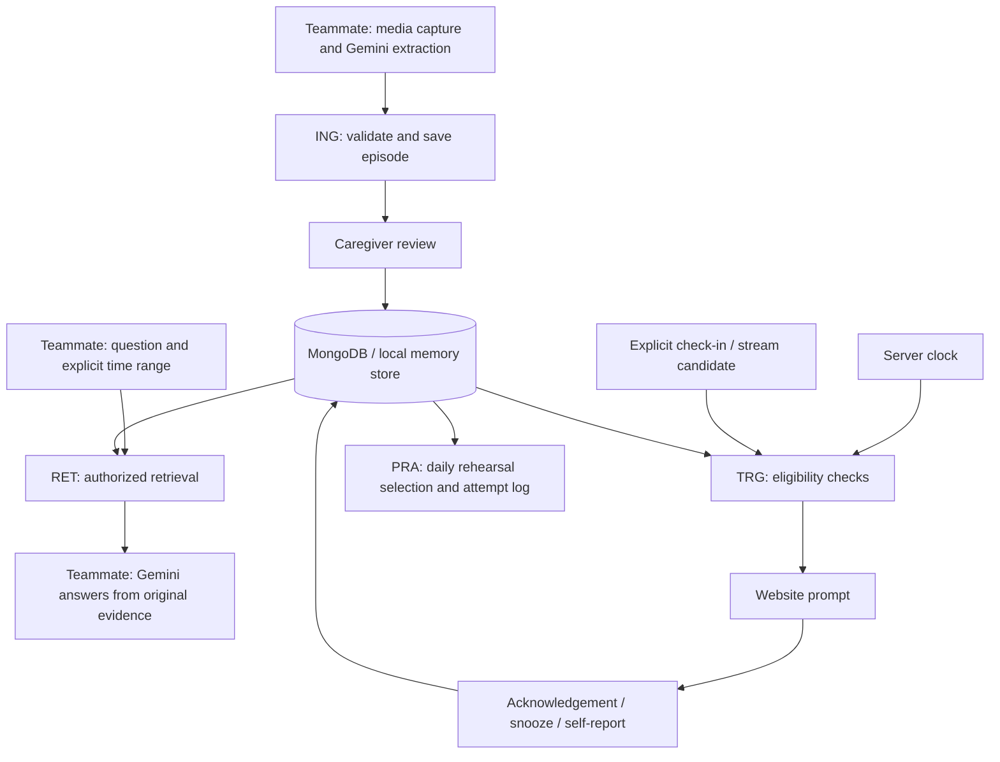
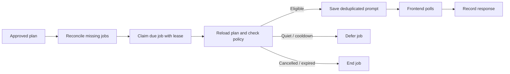

# How the implemented process works

Read [PROJECT-HISTORY.md](PROJECT-HISTORY.md) for when components were introduced. Step IDs below are stable references for debugging and future change notes. Paths are relative to `engram-retrieval/`. These descriptions follow the implementation at checkpoint H4 plus the documentation update.

## Overall flow and ownership



No always-on AI process exists here. A request, worker tick or configured external invocation starts work. Gemini generation is supplied by the teammate's backend, not run by this component.

## BOOT: configuration and service startup

| Step | Action | Main code | How to inspect |
|---|---|---|---|
| BOOT-01 | Load optional `.env`, validate modes, timezone, tokens and limits | `src/env.js`, `src/config.js` | `.env.example`; do not print secrets |
| BOOT-02 | Select in-memory store or connect to configured Atlas database | `src/store.js` | `/health` discloses mode, not provider readiness |
| BOOT-03 | Register HTTP routes, request limits, token and origin checks | `src/server.js` | HTTP status and integration tests |
| BOOT-04 | Start in-process worker unless disabled | `src/server.js` | `RUN_WORKER`, activity endpoint |

The standalone `npm run worker` uses Atlas and runs the same worker loop. For this prototype use one active worker per household: job claims are atomic, but cross-job cooldown is not a distributed per-person lock.

## ING: incoming episode and approval

```mermaid
sequenceDiagram
    participant E as Encoding teammate
    participant A as Team API
    participant S as Sources / episodes
    participant C as Caregiver
    E->>A: POST /episodes (patient_id, timestamps, gist, evidence)
    A->>A: Validate scope, types, people and provenance
    A->>S: Save original source reference and episode
    A-->>E: Episode ID; auto/draft excluded from recall
    C->>A: POST /episodes/review
    A->>S: Mark approved; append review audit event
```

1. **ING-01:** Authenticate using the caregiver/backend token. Map `patient_id` to the configured household/subject; caller cannot choose another household.
2. **ING-02:** Validate IDs, start/end times, existing person IDs, metadata and evidence. Questions are not event evidence. Future plans do not belong in episodes.
3. **ING-03:** Require existing source IDs, original text, or a media pointer. A generated gist alone is rejected. A pointer alone remains uninspected and cannot pass the text citation gate.
4. **ING-04:** Hash normalized input for retry detection. Same ID/same payload returns the saved record; changed content under the same ID returns 409. Original retries never undo later approval.
5. **ING-05:** Save source and episode. Manual embedding mode calls Voyage before episode insertion; automated mode lets Atlas index asynchronously. Source/episode writes are not one transaction; retries recover using deterministic source IDs.
6. **ING-06:** `auto` maps to draft; caregiver `carer_verified` maps to approved. Review can withdraw approval. This is episode review, not verification that medication was swallowed.

Code: `src/team-contract.js`, `src/service.js`; collections: `sources`, `episodes`, `people`, `audit_events`. Refer to [TEAM-HANDOFF.md](../engram-retrieval/TEAM-HANDOFF.md) for JSON.

## RET: question to evidence

1. **RET-01:** Teammate sends `/retrieve` or `/api/recall`. It must resolve relative dates in the patient's timezone and send explicit UTC bounds. This service doesn't infer "yesterday" automatically.
2. **RET-02:** Filter by authorized subject/household, approval, current status, optional date range and person.
3. **RET-03:** Choose local keyword, standalone text/vector, or hybrid according to mode/configuration. Local mode never claims Atlas features.
4. **RET-04:** Native hybrid tries `$rankFusion` over independent text/vector branches. Optional `$rerank` runs after fusion; projection also runs afterward.
5. **RET-05:** Reranker failure retries fusion alone; fusion failure falls back to standalone branches and application rank fusion. Actual features and warnings are reported.
6. **RET-06:** Reload canonical episode documents after search. Search indexes may lag approval/correction changes. Reject unavailable source references and return original evidence.
7. **RET-07:** Return candidates plus provenance. Optional supplied-confidence filtering is metadata filtering, not a truth guarantee.
8. **RET-08:** Teammate generates a response. `src/grounding.js` checks source/episode citation IDs for that request; it does not establish semantic truth. Render only checked claims.

| Result | Meaning | Caller behavior |
|---|---|---|
| `candidates_found` | Some source-backed candidates returned | Check whether they actually support the question |
| `no_record` | Completed retrieval found no eligible match | State no saved matching record; don't assert the event never happened |
| `retrieval_incomplete` | Some search paths failed and no usable candidate remains | Say records could not all be checked |
| HTTP 503 | Search/provider path failed | Retry appropriately; never translate into "nothing happened" |

Code: `src/search.js`, `src/store.js`, `src/service.js`, `src/team-contract.js`, `src/grounding.js`; audit event: `recall`. [NATIVE-ATLAS.md](../engram-retrieval/NATIVE-ATLAS.md) documents provider checks.

## TRG: automatic time/context assistance



1. **TRG-01:** Caregiver approves a supported `visit` or `photo_album` plan. Save event time, expiry, trigger type and version.
2. **TRG-02:** For time triggers, worker reconciliation creates any missing deterministic job. A crash between saving a plan and creating its job is recoverable.
3. **TRG-03:** For context triggers, save a fresh place check-in. Local processing creates a candidate; Atlas mode requires the Stream Processing pipeline to create it. Worker reloads the original event and matches pending intentions.
4. **TRG-04:** Worker atomically claims a due job. Lease enables recovery after interruption; bounded retries end failed jobs visibly.
5. **TRG-05:** Reload plan and check version, approval, cancellation, event/observation expiry, quiet hours and cooldown. Stale context cannot create a new current-location claim.
6. **TRG-06:** Save a prompt with a deterministic key; mark job completed. This means a prompt was created, not that a person saw it.
7. **TRG-07:** Frontend polls `/api/prompts` and rechecks canonical eligibility. Closed-page push and automatic audio are not implemented.
8. **TRG-08:** Record acknowledgement, one-minute snooze, dismissal or self-reported completion. Acknowledgement does not complete the plan. No response does not prove forgetting or distress.

Code: `src/service.js`, `src/store.js`, `src/worker.js`; collections: `plans`, `context_events`, `assistance_candidates`, `prompt_jobs`, `prompts`, `audit_events`. Native change streams are not clock schedulers; TTL deletion is not used to fire reminders.

## PRA: experimental practice and nightly preparation

1. **PRA-01:** Caregiver invokes `/admin/rehearsals/generate`; default target is tomorrow in the configured timezone. A plain nightly script calls this endpoint for configured subjects. It isn't installed as a hosting schedule automatically.
2. **PRA-02:** Select current approved past episodes, supplied confidence >= 0.8, and available original text. Exclude uninspected media and missing sources.
3. **PRA-03:** Initialize state from event time if absent. Derive retention from elapsed time and stability; no background deletion or vector modification is performed by decay.
4. **PRA-04:** Rank due candidates, save one immutable daily snapshot capped at three. Re-running does not create another batch. Withdrawn items disappear without replacements.
5. **PRA-05:** Companion fetches `/rehearsals`. Conversation/UI teammate offers opt-in practice and skip; this endpoint sends no prompt.
6. **PRA-06:** Log an explicit attempt with immutable attempt ID, cue level and caller-supplied outcome. Reserve at most one slot per selected memory/day.
7. **PRA-07:** Update stability with optimistic version checks. Answer shown gives no gain; skip preserves stability/due time. Identical retry does not apply twice.

Code: `src/memory-model.js`, `src/rehearsal.js`, `scripts/nightly.js`; collections: `memory_state`, `recall_attempts`, `rehearsal_sets`, `practice_slots`. [MEMORY-MODEL.md](../engram-retrieval/MEMORY-MODEL.md) documents formulas and caveats. Scores are experimental scheduling heuristics, not measured cognitive ability.

## LOG: distinguish four kinds of time

| Timestamp | Meaning | Example field |
|---|---|---|
| Git author/committer time | Code checkpoint metadata | `git log` |
| Event time | When an event was reported/observed | `eventStart`, team `start` |
| Recording time | When the source/episode was saved | `recordedAt` |
| Processing time | When a job or response was handled | `createdAt`, `completedAt`, `respondedAt`, audit `at` |

UTC instants are stored as BSON dates in Atlas. Local-day calculation uses the IANA timezone. IST project-history dates and London patient-calendar dates may differ for the same instant.

`GET /admin/activity?subjectId=...` returns recent jobs, prompts and selected audit events. It is not an exhaustive request log: not every read/write currently has an audit event, and practice outcomes live in their own collection. Local in-memory logs disappear on restart; Atlas records persist, subject to your deployment. No backup/export policy for runtime data is implemented here.

For investigation, record the commit SHA, mode, timezone, route, subject, relevant episode/plan/job/prompt/attempt IDs, and sanitized warnings. Preserve no real source text or secrets in public issues. Do not confuse a code rollback with database restoration.
