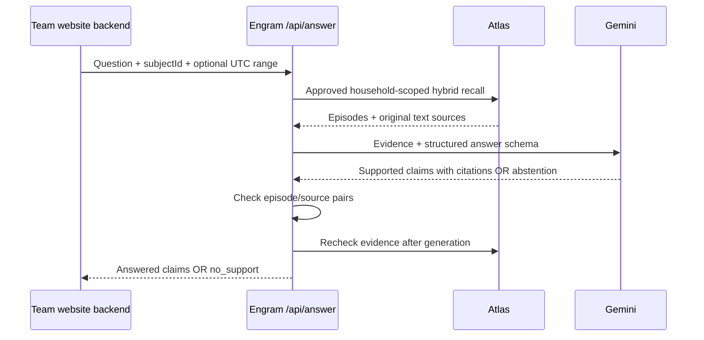

# Gemini answer bridge

Next integration milestone after live Atlas retrieval. This is a memory recall prototype, with citation checks; it does not establish clinical safety or prove that a claim follows from a source.



1. In the component's private `.env`, add `GEMINI_API_KEY` and optionally `GEMINI_MODEL` (default `gemini-4-argon`). Keep database and Gemini secrets on the backend.
2. Restart with `npm start`. The official `@google/genai` SDK uses Interactions, `store:false`, JSON Schema output and `thinking_level`. No sampling overrides are sent. Model access still requires live verification with your event credentials.
3. From your website's backend, POST to `http://127.0.0.1:4317/api/answer`, with `Authorization: Bearer <COMPANION_TOKEN>` and JSON:

```json
{"subjectId":"margaret","query":"Where were my glasses?","from":"2026-10-24T00:00:00Z","to":"2026-10-25T00:00:00Z","mode":"hybrid"}
```

4. Display `answer`. Show `claims[].citations` as evidence in the caregiver/demo view. `status:no_support` is a normal fallback; HTTP 503 indicates provider/configuration failure. Do not announce a successful answer on 503.
5. Test a supported fictional report, an unrelated question (expect model abstention), an empty date range, a draft episode, an uninspected media reference, and withdrawal of caregiver approval. Never treat retrieval similarity as proof of relevance.

The example URL assumes the website backend runs on this computer. A remote website needs a reachable backend deployment and appropriate origin configuration. Do not embed the shared companion token in a public frontend bundle.

If the teammate already owns the Gemini call, keep `/api/recall` and `examples/team-backend.js` instead. `AnswerService` also accepts an injected generator for that integration. Proactive reminders continue through the existing approved-plan worker and `/api/prompts`; answering a question does not create a reminder or confirm an activity occurred.

## Verification and limitations

Automated tests use an injected provider and cover answer/citation handling, abstention, empty/incomplete retrieval, media exclusion, withdrawn approval and missing credentials. They do not exercise Google's API. A live Gemini round trip has not yet been verified because the API key is absent.

Citation validation checks identifiers, not semantic truth. Prompt instructions request attribution, temporal caution and avoidance of medical/hazard instructions, but are not a deterministic safety classifier. Use fictional data for the hackathon and caregiver review before real use. Second retrieval can conservatively reject an answer if the candidate set changes. There remains a small race after the final check.

References: [Interactions](https://ai.google.dev/gemini-api/docs/interactions-overview), [structured output](https://ai.google.dev/gemini-api/docs/structured-output).
