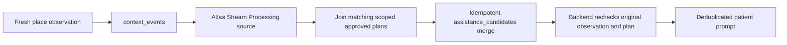

# Atlas Stream Processing: contextual assistance

This is a deployment-ready code path, not a claim of a running Atlas processor. A real workspace/connection and successful `stream:verify` result are required before claiming the competition feature.



## Prepare

1. Use the existing Atlas project and cluster. A Stream Processing workspace is a separate resource from the database cluster. Check available hackathon credits and the Atlas cost estimate when choosing resources.
2. Create/configure a Stream Processing workspace and add an Atlas connection in its Connection Registry. Name it `engramAtlas`, pointing to the existing Engram cluster. Your Atlas account and database user need the documented Stream Processing permissions; do not share credentials in chat.
3. From the canonical engram-retrieval folder run `npm run stream:prepare`. It generates `atlas/context-pipeline.json` for the configured MONGODB_DATABASE. If the connection has another name, set STREAM_CONNECTION_NAME in the private .env before preparing. No deployment, role or service setting is changed by this command.
4. In the workspace's processor creation interface, create `EngramContext` with the full generated pipeline. Start the processor. If using mongosh, connect to the **workspace** endpoint from Atlas, not the ordinary cluster endpoint, then load the local JSON:

```js
const pipeline = JSON.parse(require('fs').readFileSync('atlas/context-pipeline.json', 'utf8'));
sp.createStreamProcessor('EngramContext', pipeline);
sp.EngramContext.start();
sp.EngramContext.stats();
```

The file path assumes mongosh starts in the component folder. Do not recreate a processor under an existing name without reviewing its definition and state. Use the UI's running/error state and processor statistics to check execution.

## Verify before switching the app

Run `npm run stream:verify` while the processor is running. It connects using the ordinary private MONGODB_URI and writes fictional fixtures in a unique household. The verifier forces contextProcessing=atlas internally, so no local fallback can create its candidate. It does not change the app's .env.

The test waits approximately 60 seconds for a candidate with processingPath=atlas_stream_processing and pipelineVersion=engram-context-v1, then checks prompt creation, retry deduplication and cancellation. Database request time can extend the wait. The fixture is real-time, not a simulated clock, and must arrive before the two-minute freshness window ends. Stop/retry with a new fixture if the processor starts too late. A timeout is a failed verification, not proof the feature works. Fictional records remain for inspection; the fixture plan expires shortly after the run.

The marker is diagnostic evidence, not a cryptographic attestation: a database writer could fabricate it. For judging, show the running Atlas processor and corresponding output/statistics alongside the verification result. No code in the verifier inserts assistance_candidates.

Only after a successful run set `CONTEXT_PROCESSING=atlas` in the main backend's private .env and restart it. Keep RUN_WORKER enabled: Stream Processing produces candidates; the worker still validates and produces prompts. To roll back, set CONTEXT_PROCESSING=local and restart. Do not run the local and Atlas candidate writers as if both were proving stream use; `$merge.keepExisting` intentionally preserves the first existing candidate.

## Pipeline details

- Watches inserted place_check_in events only. `$source.config.fullDocument` uses current documented syntax.
- Validates identifier/date field types, then joins by household, patient and place, requiring approved/current planned context actions whose window contains the observation time.
- Limits lookup to one match because the backend resolves all matching plans from the authoritative data.
- Adds a version/path marker and merges by original event ID with whenMatched=keepExisting, preserving processed state under replay.
- Backend atlas mode ignores unmarked/old-version candidates. It reloads the original event, checks freshness and current plans, then applies cancellation, expiry, quiet hours, cooldown and prompt deduplication.
- Observation freshness is checked at delivery by the backend. Streaming output is only a candidate, not an instruction or evidence that an activity was completed.
- Plan must exist before the location event. Creating a plan later does not retroactively retrigger an old insert. Use a new genuine fresh observation.

## Current verification

99 local tests passed. These inspect pipeline shape and use explicitly simulated candidate fixtures for backend checks; they do not execute a real Atlas processor. A live stream verification attempt and its result are recorded in PROJECT-HISTORY.md. Active application configuration remains local until deployment verification passes.

References: [quickstart and prerequisites](https://www.mongodb.com/docs/atlas/atlas-stream-processing/quickstart/), [source syntax](https://www.mongodb.com/docs/atlas/atlas-stream-processing/sp-agg-source/), [lookup](https://www.mongodb.com/docs/atlas/atlas-stream-processing/sp-agg-lookup/), [merge](https://www.mongodb.com/docs/atlas/atlas-stream-processing/sp-agg-merge/), [processor management](https://www.mongodb.com/docs/atlas/atlas-stream-processing/manage-stream-processor/).
