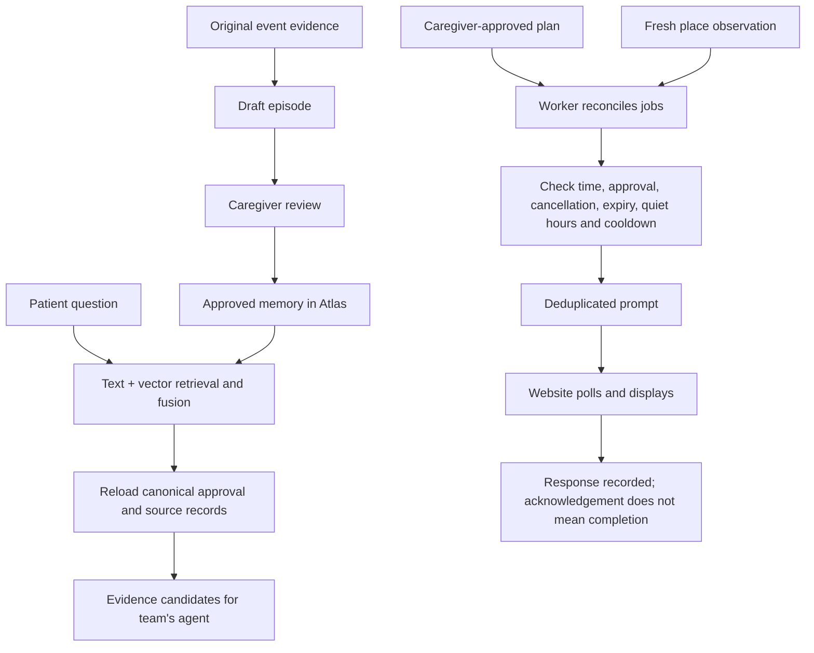

# Your assigned component: retrieval and proactive triggers

Scope: retrieve approved memories from MongoDB with original evidence, and condition proactive prompts on caregiver-approved plans, time and fresh place observations. Device/guardian extensions and the game demo are parked. The optional Gemini bridge is not needed to use this component.

## Team connection points

| Owner / action | Endpoint | Credential |
| --- | --- | --- |
| Encoding teammate submits a draft event and original text evidence | POST /episodes | Backend admin |
| Caregiver approves or withdraws event | POST /episodes/review | Backend admin |
| Agent retrieves candidate memories | POST /retrieve | Backend companion |
| Caregiver approves visit/photo-album plan | POST /plans | Backend admin |
| Caregiver cancels plan | POST /plans/cancel | Backend admin |
| Website backend sends fresh place observation | POST /context-events | Backend companion |
| Website backend polls deliverable prompts | GET /prompts?patient_id=... | Backend companion |
| Patient acknowledges, snoozes, dismisses or self-reports completion | POST /prompts/respond | Backend companion |

All use patient_id and the deployment's household/patient allowlist. Shared service tokens stay on the backend. Website authentication and mapping the logged-in user to their allowed patient remain the team's responsibility.

Full payloads: [TEAM-HANDOFF.md](TEAM-HANDOFF.md). Client and forwarding example: [WEBSITE-INTEGRATION.md](WEBSITE-INTEGRATION.md).

## How it works



Retrieval returns candidates, not confirmed answers. Missing search branches are reported; an outage is not proof an event never happened. Drafts and withdrawn approvals are excluded through canonical database checks even if the search index lags. Sources retain provenance and uninspected media flags. Explicit time ranges use inclusive start and exclusive end.

The worker handles time/context triggers without a question or Gemini call. Context observations are fresh for two minutes. Identical retries preserve observations and recover a missing trigger-candidate write; changed content under an existing event ID returns 409. Jobs use leases, retries and deduplication. Existing tests exercise quiet hours, cooldown, lease recovery, scope, expiry, cancellation and London daylight-saving boundaries.

## Verification checkpoint

Verified at **2026-10-23T22:51:19.065Z** (24 October 04:21:19.065 IST; 23 October 23:51:19.065 London).

- `npm test`: **83 passed**, using local stores/mocked providers and localhost HTTP tests.
- `npm run verify:core`: **9 acceptance checks passed locally**.
- `npm run verify:core -- --atlas`: **the same 9 checks passed with live Atlas**.
- Atlas execution reported Search, Vector Search, native rank fusion and automated Voyage embedding. Native reranking and Stream Processing are not claimed.

Checks: draft exclusion; approved memory with source; ingestion deduplication; withdrawn approval exclusion; time trigger once; snooze and return; acknowledgement not completion; context trigger once; cancellation suppressing delivery.

Live fixture household: `verify_97d774067aa847e69d5268a6415c3dac`. All records are fictional and retained for review. The verifier used an isolated household, controlled clock, zero cooldown and disabled quiet hours only in its own config. This proves database-backed workflow execution, not elapsed real-time delivery or clinical benefit. HTTP behavior is covered separately by local tests. Active household configuration was not modified.

## Re-run / handoff

```powershell
npm ci --ignore-scripts --no-audit --no-fund
npm test
npm run verify:core
# Uses private .env Atlas connection and writes isolated fictional fixtures:
npm run verify:core -- --atlas
npm start
```

Run from this canonical repository's engram-retrieval folder. Start only one server on the configured port. Keep RUN_WORKER enabled when using the main server for prompt creation. Use `SUBJECT_IDS` consistently. All future plans/timestamps need to match the actual current window. Approved memories must be past events. Polling is required to display prompts; this backend does not deliver mobile push/audio itself.

## Boundaries

This assigned hackathon component is implemented and verified at the checkpoint above. Remaining team integration: authenticated website routes, original observations, caregiver controls, agent relevance/entailment checking, and patient display/voice. Continuous GPS/Bluetooth, geofences, guardian calls, face recognition and the game are outside this delivery. Existing device-assistance code remains available but is not part of this completion claim.

Production limitations: shared service credentials rather than individual user sessions; no cross-collection transaction or retention cleanup; bounded prototype queries/worker scans; no guarantee of exactly-once human viewing across reconnections; only visit/photo-album prompt templates. This is not a clinically validated memory replacement.
